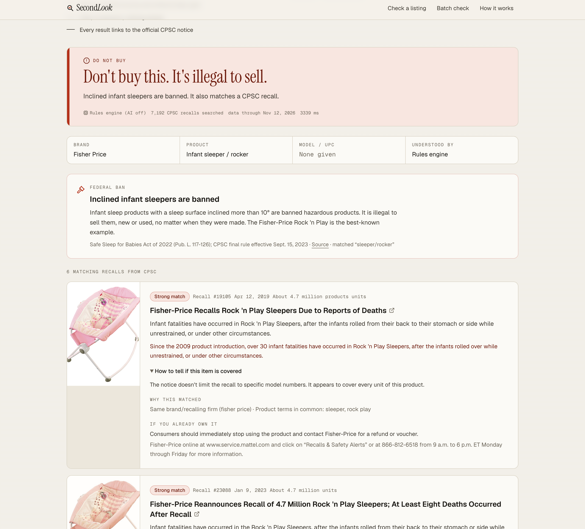
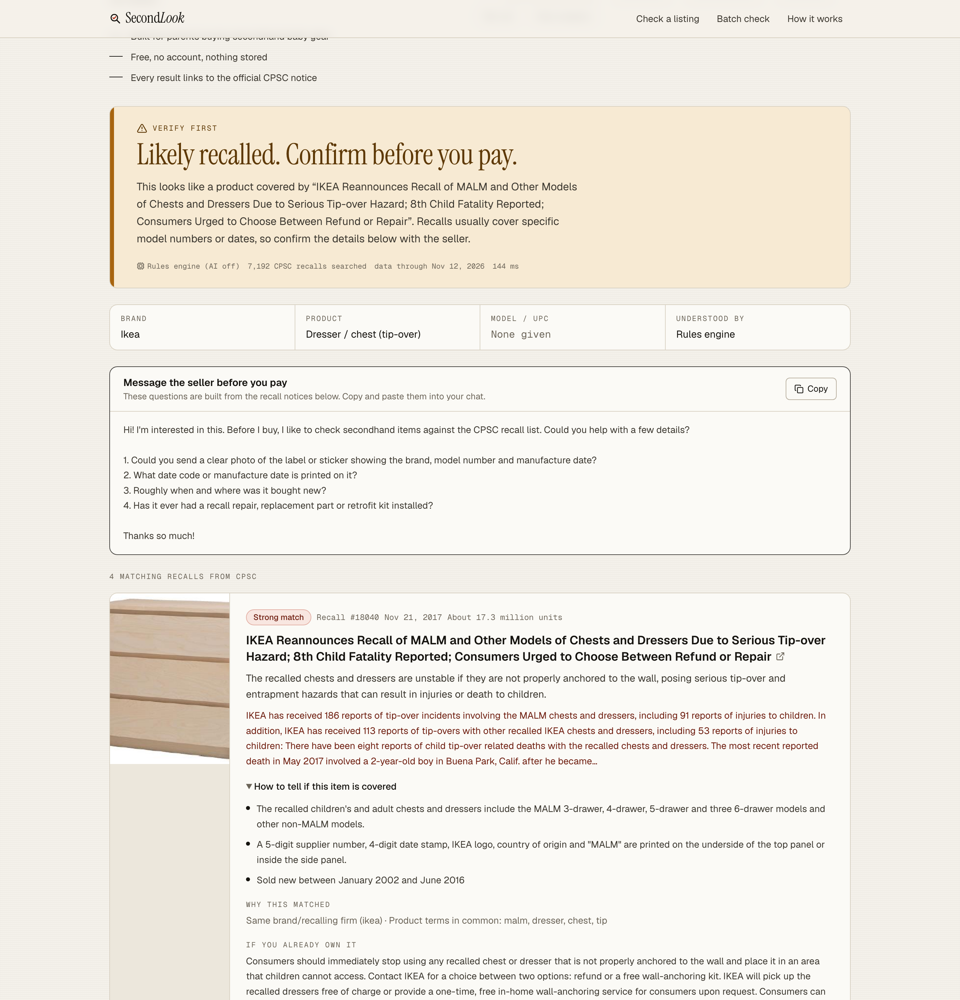
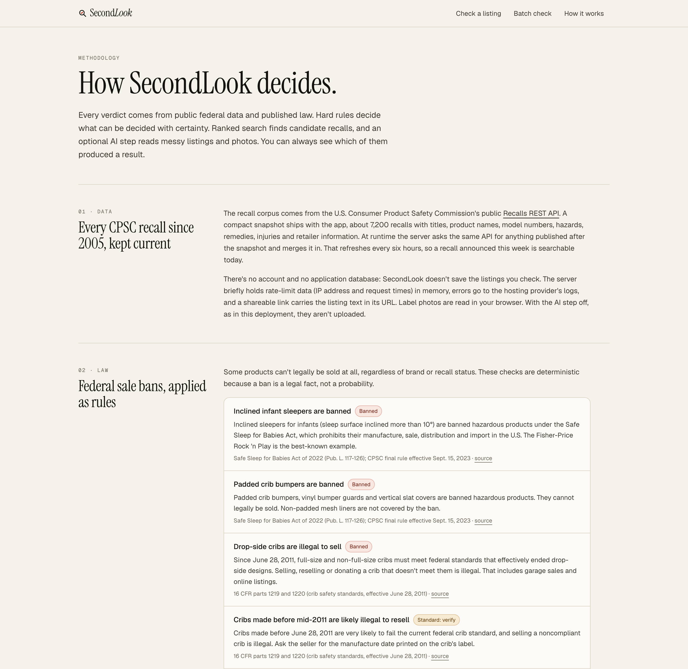
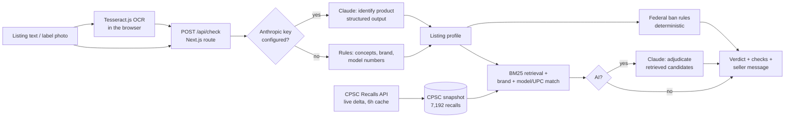

# SecondLook

**Look twice before you buy it used.**

SecondLook checks a secondhand listing, or a photo of its label, against every U.S. Consumer Product Safety Commission (CPSC) recall since 2005 and against federal sale bans. It then tells you exactly what to ask the seller before you pay.

**Live app:** https://secondlook-nu.vercel.app  
**Demo video (2:33):** https://youtu.be/q6ousB0I6-I. Built from real footage of the live app; production sources are in [`submission/video/`](submission/video/README.md).  
Built for [IceHacks 2026](https://icehacks.devpost.com/).



---

## The problem

A recall stops new sales. It doesn't stop resales.

- CPSC staff reported a **65% overall correction rate** across 865 closed Section 15 cases from FY 2014–2016, a figure that counts corrections by manufacturers, distributors, retailers and consumers together ([CPSC Recall Effectiveness Workshop report, 2018](https://www.cpsc.gov/s3fs-public/Recall_Effectiveness_Workshop_Report-2018.pdf)). Recalled products that stay in circulation can resurface on Facebook Marketplace, Craigslist and garage-sale tables.
- In 2026, Consumer Reports found banned infant products (inclined sleepers, drop-side cribs, padded crib bumpers, in-bed sleepers) listed on **every major resale platform** ([Consumer Reports](https://www.consumerreports.org/babies-kids/how-to-avoid-unsafe-used-baby-gear-when-shopping-online-a7805010094/)).
- Federal law already makes it unlawful to sell a product that is subject to a CPSC recall ([15 U.S.C. § 2068(a)(2)(B)](https://www.law.cornell.edu/uscode/text/15/2068)). But the official search tools expect the exact product name or model number, and listings rarely have either. Consumer Reports found the recalled Rock 'n Play listed as "baby sleeper/rocker", "floor cradle" and "bassinet".

## Try it in 30 seconds

1. Open https://secondlook-nu.vercel.app.
2. Click the **"Baby sleeper/rocker"** example: a vague listing gets flagged as a banned, recalled product, with the actual CPSC notice.
3. Click **"Infant swing"**: a narrower recall. Copy the seller message and see which models the notice covers.
4. Click **Add label photo** and upload [`submission/assets/sample-label.png`](submission/assets/sample-label.png): text is read in your browser, and the model number feeds the check.
5. Open **Batch check** → **Load sample intake list** → **Export CSV**.

## What SecondLook does

1. **Paste a listing, or snap the label.** Text recognition runs in your browser (Tesseract.js), so the photo never has to leave your device.
2. **Federal ban check.** Deterministic rules for categories restricted by federal law regardless of brand:
   - inclined sleepers for infants and crib bumpers, banned hazardous products under the Safe Sleep for Babies Act of 2022
   - lawn darts (16 CFR 1306)
   - drop-side cribs, which can't meet the crib standards that cribs sold since June 28, 2011 must meet (16 CFR 1219/1220)
   - "verify" warnings for cribs that may predate mid-2011 and for infant sleep products under 16 CFR 1236

   Each rule cites its source.
3. **Recall search.** Ranked retrieval over 7,192 CPSC recalls, plus anything published since the last build, fetched live from the CPSC API.
4. **A clear verdict.** *Don't buy*, *Verify first* or *No matching recall*, with the evidence: recall image, hazard, injuries, units affected and a link to the official notice.
5. **What to verify.** Model numbers, date codes and sale windows are pulled from the recall notice, then turned into a **ready-to-send message for the seller**.
6. **Batch mode** for thrift stores, donation drives and sellers: paste an intake list and get a sorted flag table plus a CSV export.

| Verify-first result | Methodology |
|---|---|
|  |  |

## How it works



**The matching engine** (`src/lib/match.ts`) is purpose-built for the gap between how people *list* items and how CPSC *writes* recalls:

- **Vocabulary bridge.** 23 product concepts map listing slang ("pack n play", "sleeper/rocker", "dresser") to recall vocabulary ("play yard", "inclined sleeper", "chest", "tip-over").
- **Field-weighted BM25** over titles, product names, product types, firms and descriptions, including two-word phrases.
- **Brand resolution** against recalling firms *and* licensed brand names (e.g. "Sharper Image-branded … recalled by Allstar"). A brand mismatch discounts a candidate heavily.
- **Exact identifiers.** Model numbers and UPCs from the listing or label are matched against the recall's identifiers.
- **Strength grading** (strong / possible / weak), with a plain "why this matched" for every candidate. Within a tier, exact product-line matches come first, then recalls tied to deaths or injuries.

**Data freshness** (`src/lib/recalls.ts`): `scripts/sync-cpsc.mjs` builds a compact snapshot from the [CPSC Recalls REST API](https://www.saferproducts.gov/RestWebServices). At runtime the server fetches every recall published since the snapshot date and merges it in, refreshed every 6 hours. If CPSC is unreachable, the snapshot still serves.

## AI implementation

AI is used where it adds something, and kept away from decisions it shouldn't make.

- **Model:** Claude (`claude-opus-5-5` by default, configurable through `ANTHROPIC_MODEL`) via the official `@anthropic-ai/sdk`, using **structured outputs** (`output_config.format` with Zod schemas) and the server-side refusal fallback.
- **Step 1, understand:** reads the listing and, optionally, the label photo (vision). It returns brand, likely official product line, visible model numbers and recall-style search phrases. These *feed* the retrieval; they don't replace it.
- **Step 2, adjudicate:** compares the listing with the recalls the engine retrieved and returns, per recall, `same_product` / `possibly_same` / `different`, a plain-language reason, and what to check on the physical item.
- **Guardrails:** Claude can only judge candidates retrieved from CPSC data, so it cannot invent recalls. Federal bans are never decided by the model. Outputs are schema-validated, and unknown recall IDs are discarded. Any AI failure falls back to the rules engine, and every result is labeled with the engine that produced it ("AI-assisted" or "Rules engine (AI off)").
- **Cost control:** a per-IP rate limit; batch mode is rules-only by design.

> **Current deployment status:** the public deployment runs in **rules-engine mode** (no API key configured), and every result is labeled "Rules engine (AI off)". Everything described above under "What SecondLook does" works without a key. The Claude steps are implemented but have not been run against the live API.

## Tech stack

- **Next.js 16** (App Router, route handlers), **React 19**, **TypeScript**
- **Tailwind CSS v4**; Instrument Serif, Geist and Geist Mono via `next/font`; Lucide icons
- **Tesseract.js** for in-browser OCR
- **Anthropic TypeScript SDK** with **Zod** for structured outputs
- **Vercel** hosting
- Data: **CPSC Recalls REST API** (public domain U.S. government data)

## Run it locally

```bash
git clone https://github.com/Sidd927/secondlook.git
cd secondlook
npm install
cp .env.example .env.local   # optional: add ANTHROPIC_API_KEY to enable the AI steps
npm run dev                  # http://localhost:3000
```

Refresh the recall snapshot (optional; the server also fetches new recalls live):

```bash
node scripts/sync-cpsc.mjs 2005-01-01
```

Run the matching smoke test against sample listings:

```bash
npx tsx scripts/smoke.mts
```

### Environment variables

| Variable | Required | Purpose |
|---|---|---|
| `ANTHROPIC_API_KEY` | No | Enables the Claude understanding and adjudication steps |
| `ANTHROPIC_MODEL` | No | Overrides the model (default `claude-opus-5-5`) |

## Project structure

```
src/
  app/
    page.tsx               landing page + checker
    batch/                 batch screening page
    how-it-works/          methodology, sources, limits
    api/check/route.ts     POST: check a listing · GET: status + warm-up
    api/batch/route.ts     POST: screen up to 200 items (rules engine)
  components/              Checker, ResultView, BatchChecker, site chrome
  lib/
    recalls.ts             snapshot + live CPSC delta + search index
    match.ts               retrieval, brand/model matching, strength grading
    taxonomy.ts            listing-slang → recall-vocabulary concepts
    bans.ts                federal sale-ban rules with citations
    ai.ts                  Claude structured-output steps
    check.ts               orchestration and verdict logic
data/recalls.json          compact CPSC snapshot (generated)
scripts/                   snapshot sync + smoke test
```

## Challenges

- **Listing language ≠ recall language.** Keyword search on "baby sleeper/rocker" misses "Rock 'n Play". The concept taxonomy plus phrase-aware BM25 fixed it, but it also caused false positives (concept terms alone matching unrelated recalls). The fix: concept expansions can *support* a match but never *create* one without a term from the listing itself.
- **Brands hide behind licensees.** Sharper Image fire pits were recalled by Allstar. We mine "X-branded" and "sold under the X brand" phrases from notices to resolve these.
- **Short model numbers collide.** "TR02" partially matched an unrelated recall. Exact-token matching for short identifiers, plus requiring brand agreement for a strong match, fixed it.
- **Cold starts on serverless.** The page-load status request goes to the same function that serves checks, so the index is already warm for the first real check.

## Roadmap

- A browser extension that annotates Marketplace/Craigslist listings in place
- NHTSA car-seat and Health Canada recalls
- SMS/WhatsApp check-by-photo
- Point-of-intake integration for thrift stores
- Saved checks and recall alerts for items you bought

## Limits

"No matching recall found" is not a safety certification. Coverage is CPSC consumer-product recalls since 2005. SecondLook is independent and not affiliated with the CPSC; always confirm on the official notice linked in each result. See [/how-it-works](https://secondlook-nu.vercel.app/how-it-works).

## AI-assisted development disclosure

- **Building it:** this project was built during IceHacks 2026 (Nov 15, 2026) with substantial help from **Claude Code (Anthropic)**, an AI coding assistant. It was used for research, product strategy, most of the code, the demo-video production and documentation. The team directed the work, reviewed it, and is responsible for the result.
- **In the product:** every verdict comes from the deterministic rules engine. The only machine-learning component running live is browser-based Tesseract.js OCR. The optional Anthropic (Claude) integration described above is **disabled** in the public deployment.
- **In the video:** the narration is synthetic (Kokoro-82M, generated locally), the music is original and was synthesized in code, and every product shot is real screen capture of the live app.

## Credits

- Recall data: [U.S. Consumer Product Safety Commission](https://www.cpsc.gov/) Recalls API (public domain). Recall images are hot-linked from cpsc.gov.
- Research cited: CPSC Recall Effectiveness Workshop report (2018), Consumer Reports (2026), NBC News (2023), GAO and CPSC rulemaking pages.
- Open source: Next.js, React, Tailwind CSS, Tesseract.js (Apache-2.0), Lucide (ISC), Zod (MIT), Anthropic TypeScript SDK (MIT); fonts Instrument Serif and Geist (SIL OFL).

## License

MIT. See [LICENSE](LICENSE).
